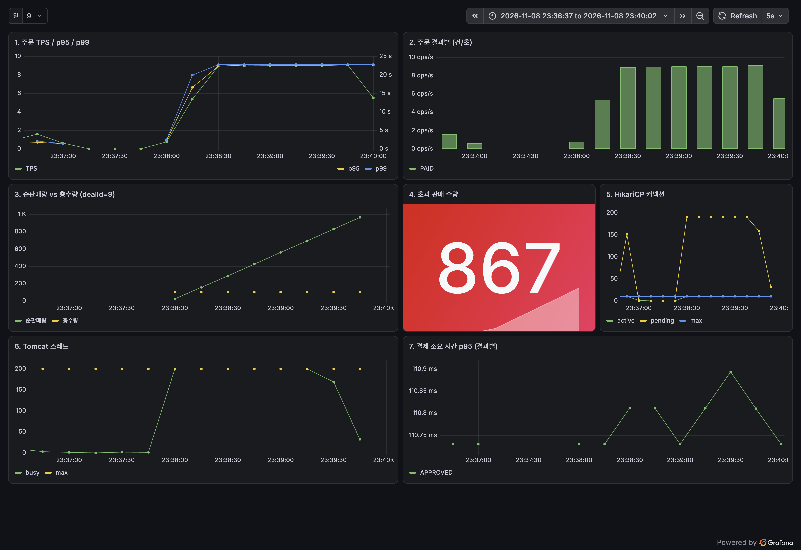
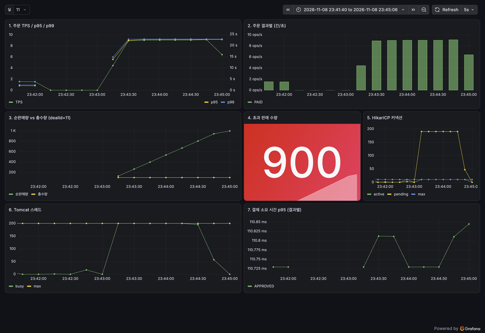
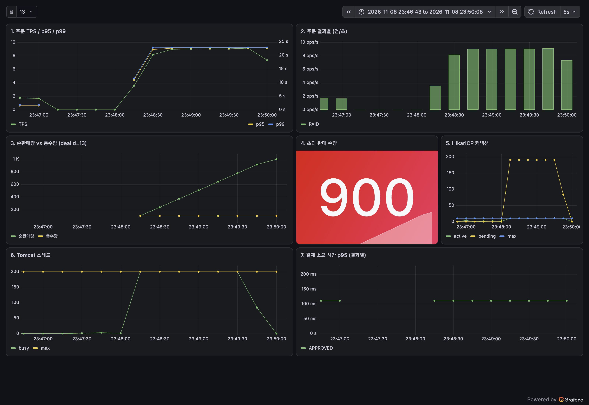
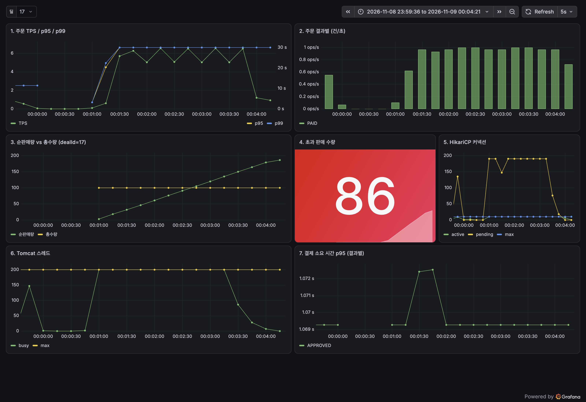
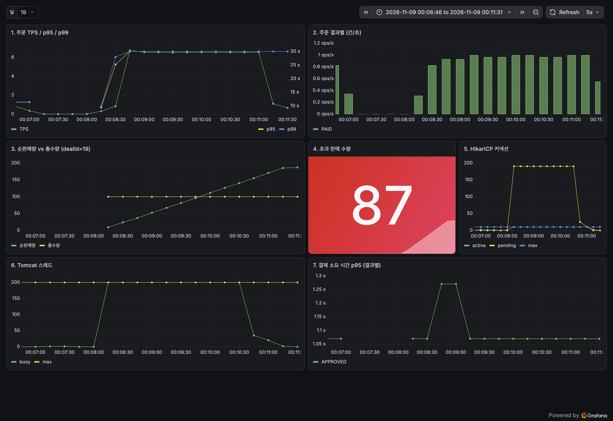

# Phase 2 기준선 측정 리포트 (타임딜 오픈 시점, 락 없는 모놀리식)

측정일: 2026-11-08 ~ 11-09. 코드 기준: Phase 1 모놀리식 그대로(락·동시성 제어 없음). Phase 3, 4의 개선 효과를 같은 조건에서 비교하기 위한 **기준선**이다. 절대 수치가 아니라 "무엇이 어떻게 깨지는가"가 목적이다.

## 1. 환경과 조건

| 항목 | 값 |
|---|---|
| 호스트 | Mac 10코어 / 32GB, macOS 26.6.2, Docker Compose (`compose.yaml` + `compose.perf.yaml`) |
| 자원 제한 | app 2 CPU / 1.5GB, mysql 2 CPU / 2GB, redis 0.5 CPU / 256MB |
| 앱 설정(기본값 그대로) | HikariCP maximum-pool-size 10, Tomcat max threads 200 |
| 부하 도구 | k6 v2.2.0, 1,000 VU(= 사용자 1,000명), 각자 오픈 시각(`openAt`)에 `POST /orders` 1건(수량 1) |
| 딜 | 재고 100, 1인 1개 제한, 오픈 전 약 60초간 사용자들이 1~2초 간격으로 `GET /deals/{id}` |
| 주문 도착 | 1,000건이 수십 ms 안에 도착(`orderSendOffsetMs.spread` 19~43ms), 지연 도착 0건, k6 dropped 0 |
| 클라이언트 타임아웃 | 90초(HikariCP 대기 30초보다 길게) |
| 조건 A | Mock PG 지연 100ms (정상 PG) |
| 조건 B | Mock PG 지연 1초 (느린 PG). 실패율 0, PG 타임아웃 3초 |
| 사전 준비 | 앱만 재시작 -> 회원 1,000명 준비(측정 밖) -> 워밍업 딜 주문 50건 -> 새 딜 생성 -> 측정. 회원 준비는 첫 조회보다 23초(A) / 69초(B) 먼저 끝남 |
| 측정 후 | 서버가 비워질 때까지(Hikari active 0, Tomcat busy 기준값 이하, 주문 행 수 5초 불변) 대기한 뒤 DB와 메트릭 집계. 모든 run에서 시간 초과 없음 |

측정 오버헤드: 분산 추적 **샘플링 100%**, 로그는 **JSON 파일 로깅**이 켜져 있다. 운영 설정보다 무겁고, 이 값은 A, B 모두 동일하다. 한 번에 한 run만 돌렸고 다른 무거운 프로세스는 없었다.

실행 명령(조건당 3회, 기본 라벨 = 타임스탬프 디렉터리):
```
perf/scripts/run-baseline.sh A   # x3
perf/scripts/run-baseline.sh B   # x3
```
원자료: `perf/results/<타임스탬프>-<A|B>/result.json` (+ `phases.json`, `k6-summary.json`).

## 2. 조건 A: PG 100ms

| 지표 | run1 (233452) | run2 (233958) | run3 (234502) | 중앙값 |
|---|---|---|---|---|
| DB PAID 수량 | 999 | 1000 | 1000 | **1000** |
| 초과 판매 수량 (PAID - 재고 100) | 899 | 900 | 900 | **900** |
| 재고 최종값 (remaining) | 0 | 0 | 0 | **0** |
| lostUpdateGap (판매 - 실제 차감) | 899 | 900 | 900 | **900** |
| SOLD_OUT 응답 | 0 | 0 | 0 | 0 |
| 메트릭 sold = DB PAID | 999 일치 | 1000 일치 | 1000 일치 | 일치 |
| 클라이언트 201 | 807 | 810 | 810 | 810 |
| 클라이언트 500 | 1 | 0 | 0 | 0 |
| 클라이언트 타임아웃(status 0) | 192 | 190 | 190 | **190** |
| 응답 받은 주문 p50 (초) | 45.2 | 45.2 | 45.2 | 45.2 |
| 응답 받은 주문 p95 (초) | 85.4 | 85.5 | 85.5 | **85.5** |
| 응답 받은 주문 p99 / max (초) | 89.0 / 89.9 | 89.1 / 90.0 | 89.0 / 89.9 | 89.0 / 89.9 |
| (타임아웃 포함) p95 (초) | 90.0 | 90.0 | 90.0 | 90.0 |
| Hikari pending 최대 | 190 | 190 | 190 | **190** |
| Hikari active 최대 | 10 | 10 | 10 | 10 |
| Tomcat busy 스레드 최대 | 200 | 200 | 200 | 200 |
| 결제 호출 p95 (초) | 0.111 | 0.111 | 0.111 | 0.111 |
| 앱 프로세스 CPU 최대 | 1.0 | 1.0 | 1.0 | 1.0 |
| drain 시간 (초) | 22 | 23 | 22 | **22** |

참고: 응답 받은 주문 p95는 status 0(클라이언트 타임아웃)을 제외한 값이다. 타임아웃 포함 지표는 90초 상한에 붙는다. run1의 500 한 건은 DB에 행이 없다(행 999).

스크린샷 (Grafana, 3회 모두 첨부. 대표 run은 run2):


[Grafana 원본](http://localhost:3000/d/kairos-timedeal?orgId=1&from=1794148597000&to=1794148802000&var-dealId=9)


[Grafana 원본](http://localhost:3000/d/kairos-timedeal?orgId=1&from=1794148900000&to=1794149106000&var-dealId=11)


[Grafana 원본](http://localhost:3000/d/kairos-timedeal?orgId=1&from=1794149203000&to=1794149408000&var-dealId=13)

## 3. 조건 B: PG 1초

| 지표 | run1 (235004) | run2 (235711) | run3 (000417) | 중앙값 |
|---|---|---|---|---|
| DB PAID 수량 | 187 | 186 | 187 | **187** |
| 초과 판매 수량 | 87 | 86 | 87 | **87** |
| 재고 최종값 (remaining) | 81 | 81 | 81 | **81** |
| lostUpdateGap | 168 | 167 | 168 | **168** |
| SOLD_OUT 응답 | 0 | 0 | 0 | 0 |
| 메트릭 sold = DB PAID | 일치 | 일치 | 일치 | 일치 |
| 클라이언트 201 | 87 | 87 | 87 | 87 |
| 클라이언트 500 (INTERNAL_ERROR) | 325 | 325 | 327 | **325** |
| 클라이언트 타임아웃(status 0) | 588 | 588 | 586 | **588** |
| 응답 받은 주문 p50 (초) | 43.9 | 44.1 | 43.4 | 43.9 |
| 응답 받은 주문 p95 (초) | 68.2 | 68.5 | 68.7 | **68.5** |
| 응답 받은 주문 p99 / max (초) | 85.0 / 89.1 | 85.2 / 89.4 | 85.5 / 89.7 | 85.2 / 89.4 |
| (타임아웃 포함) p50 / p95 (초) | 90.0 / 90.0 | 90.0 / 90.0 | 90.0 / 90.0 | 90.0 / 90.0 |
| Hikari pending 최대 | 190 | 190 | 190 | **190** |
| Hikari active 최대 | 10 | 10 | 10 | 10 |
| Tomcat busy 스레드 최대 | 200 | 200 | 200 | 200 |
| 결제 호출 p95 (초) | 1.070 | 1.070 | 1.071 | 1.070 |
| 앱 프로세스 CPU 최대 | 1.0 | 1.0 | 1.0 | 1.0 |
| drain 시간 (초) | 103 | 102 | 103 | **103** |

스크린샷 (Grafana, 3회 모두 첨부. 대표 run은 run2):


[Grafana 원본](http://localhost:3000/d/kairos-timedeal?orgId=1&from=1794149549000&to=1794149835000&var-dealId=15)


[Grafana 원본](http://localhost:3000/d/kairos-timedeal?orgId=1&from=1794149976000&to=1794150261000&var-dealId=17)


[Grafana 원본](http://localhost:3000/d/kairos-timedeal?orgId=1&from=1794150406000&to=1794150691000&var-dealId=19)

## 4. 해석

### 4.1 초과 판매가 생기는 이유
주문 처리는 하나의 트랜잭션 안에서 **재고 조회 -> 남은 수량 검사 -> 차감 후 저장**을 락 없이 수행하고, 같은 트랜잭션 안에서 **동기 PG 호출**(조건 A 100ms, B 1s)이 끼어 있다. 오픈 순간 1,000건이 수십 ms 안에 몰리면, 수많은 트랜잭션이 아직 아무도 차감하지 않은 같은 재고 값(100)을 읽고 "남음"으로 판단해 통과한다. 검사와 저장 사이에 락이 없으므로 이 판단은 서로를 반영하지 못한다.

조건 A에서는 1,000건 전부가 결제 승인, PAID가 됐다(재고 100에 대해 약 10배). 재고 검사가 사실상 아무 역할도 못 한 것이다. SOLD_OUT 응답은 한 건도 없었다.

### 4.2 remaining이 0인데 판매는 훨씬 많은 이유 (lost update)
재고 읽기(`findByDealId`)는 **락을 걸지 않는 스냅샷 읽기**이고, 읽은 뒤 Java에서 `remaining - 수량`을 계산해 그 값을 `UPDATE`로 **덮어쓴다**(`remaining = 계산값`, 증분 UPDATE가 아님). 커넥션을 쥔 약 10개 트랜잭션은 같은 값을 읽고 행 락을 차례로 얻어 모두 "읽은 값 - 1"을 저장하므로, 차감이 합쳐져 사라진다. 결과적으로 remaining은 커밋 약 10건당 1씩만 줄어든다.
- 검증 A: 판매 1,000 / 동시 약 10 = 약 100번 감소 -> 100에서 0 (remaining 0, lostUpdateGap 900).
- 검증 B: 판매 187 / 약 10 = 약 19번 감소 -> 100 - 19 = 81 (관측 remaining 81, lostUpdateGap 168).
총 차감 가능량이 100이므로 실제 차감은 최대 100이고, 판매와의 차이가 lostUpdateGap이다(`판매 - (총재고 - 남은재고)`). 재고가 0이 아닌 81인데 100을 넘게 팔렸다는 점이 이 결함의 성격을 보여준다.

### 4.3 DB와 메트릭 일치
`kairos_deal_sold` 메트릭과 DB의 PAID 수량은 6회 모두 일치했다(`soldMatches=true`). 메트릭의 초과 판매 게이지도 DB 기준 값과 같은 방향이다. 따라서 이 대시보드로 Phase 3 이후의 개선 여부를 확인할 수 있다.

A run1의 Grafana stat 패널 값(867)이 표의 899/900과 다른 이유: stat 패널은 조회 구간 안의 **마지막 샘플**을 보여주므로, 서버가 아직 주문을 처리하던 중의 값일 수 있다. 최종 값은 drain 후 집계한 이 문서의 표(DB 기준)이다.

측정 공백: HikariCP 커넥션 대기 타임아웃으로 인한 500은 `@Transactional` 프록시에서 `OrderService.place` 본문 진입 전에 발생하므로 `kairos_order_placed`에 기록되지 않는다(B 메트릭에는 PAID만 보임). 이 500은 k6 집계(상태 코드별 수)에서만 보인다. Phase 3에서 필터, 어드바이스 등 트랜잭션 바깥에서 집계하도록 보완한다(지금은 고치지 않음).

### 4.4 클라이언트가 본 결과와 서버 사실의 차이
A에서 약 190건은 90초 타임아웃으로 클라이언트에는 "실패"(status 0)였지만, 서버는 요청을 계속 처리해 모두 PAID로 커밋했다(A run2: 201 810 + 타임아웃 190 = DB PAID 1000). B에서는 DB PAID 187건 중 클라이언트가 성공(201)으로 받은 것은 87건뿐이고, 약 100건은 클라이언트가 타임아웃으로 알게 된 뒤에 서버에서 결제와 주문이 완료됐다. 사용자는 실패로 알았는데 돈은 빠진 상태이므로, 재시도 시 중복 결제, 사용자 신뢰 문제로 이어진다. 요청 취소가 서버 처리 취소로 이어지지 않는다는 점(서버가 비워지는 데 A 22초, B 103초가 더 걸림)도 이 증상의 일부다.

### 4.5 병목: 재고 행 락이 동기 PG 호출 동안 유지됨
관측된 처리량(주문 행의 `created_at` 기준 첫 주문~마지막 주문, 6회 모두 DB 조회): **A 약 9~10건/초**(1,000건 / 110초), **B 약 1건/초**(187건 / 189초, 186/188초, 187/190초). 이는 "풀 10 x (1 / PG 지연)"(A 100건/초, B 10건/초) 모델과 맞지 않고, **1 / PG 지연**(A 10/초, B 1/초)과 맞는다. 즉 커넥션 10개가 병렬로 일하지 않고 사실상 **직렬화**되어 있다. Grafana의 주문 처리량 패널(패널 2)도 같은 평탄한 곡선을 보여준다.

원인은 코드 순서다. `StockRepositoryImpl.save`가 `saveAndFlush`를 쓰므로 `OrderService.doPlace` 4단계(재고 차감)의 `UPDATE stock`이 **6단계 동기 PG 호출보다 먼저** DB로 나가고, InnoDB는 단일 재고 행의 X 락을 **커밋까지** 쥔다. 나머지 약 9개 트랜잭션은 커넥션을 쥔 채 그 행 락에서 PG 대기시간 내내 막힌다. 그래서 A는 100ms, B는 1초마다 한 건씩 커밋된다.

풀 크기 10은 **부차적 상한**이다. 락 대기자가 커넥션을 점유하므로 풀이 모두 차고(active 최대 10), 나머지는 풀 앞에서 대기한다(pending 최대 190). 대기가 30초를 넘기면 `HikariPool-1 - Connection is not available, request timed out after 30002ms` 로 **500(INTERNAL_ERROR) 약 325건**(B)이 되고 이 건들은 DB에 행이 없다. Tomcat 스레드 200개도 모두 점유(busy 최대 200)된다. 그 결과 B에서 1,000건 중 정상 응답(201)은 87건이고, 클라이언트 타임아웃은 약 588건이며 그중 약 100건은 서버가 이후 커밋했다(4.4).
A에서도 같은 구조(pending 190, Tomcat 200 포화)지만 커밋이 초당 약 10건이라 대부분 90초 안팎에 끝난다. 앱 프로세스 CPU 최대 1.0은 관찰값일 뿐 병목의 주원인으로 보지 않는다(처리량이 1/PG 지연에 정확히 비례하므로). 로컬 측정에서는 여러 한계가 겹쳐 있을 수 있다.

### 4.6 다음 Phase의 근거
- **Phase 3(락)**: 4.1~4.2의 초과 판매와 lost update는 재고 차감을 원자적으로 만들어야(비관적 락, 조건부 UPDATE 등) 해결된다. 그러나 이미 재고 행 락이 PG 호출 구간을 포함하고 있으므로, **비관적 락만 추가하면 초과 판매는 고쳐도 B의 약 1건/초 처리량은 그대로**다. 핵심 레버는 **임계 구역을 줄이는 것**, 즉 PG 호출을 재고 락 트랜잭션 밖으로 빼는 것(재고 선점 커밋 -> PG 호출 -> 확정/복구)이다. 같은 명령으로 재측정해 초과 판매 0, remaining과 판매의 일치, B의 커밋 처리량을 기준으로 삼는다.
- **Phase 4(결제 분리)**: 결제 호출이 DB 커넥션과 락을 점유하는 구조가 병목의 뿌리다. 결제를 트랜잭션과 요청 스레드에서 분리(비동기, 별도 서비스, 보상 트랜잭션)하면 점유 시간이 PG 지연과 무관해진다. 4.4의 "클라이언트는 실패, 서버는 완료" 문제는 상태 조회, 멱등성 설계로 다룬다.
- 측정 보완(Phase 3): 4.3의 500 미집계 공백을 메트릭에 포함한다.

## 5. 변동성
조건 안에서 결과는 매우 일관됐다(A: 초과 899~900, B: 86~87, Hikari pending는 6회 모두 190). 다만 경합은 비결정적이므로 이 일관성이 보장된 것은 아니다. 변동은 주로 (1) 어떤 요청이 90초 안에 응답받는지(타임아웃 190 vs 192, B 588 vs 586), (2) A run1의 500 한 건처럼 드문 오류, (3) 소수의 행 수에서 나타났다. 표본이 조건당 3회뿐이라 통계적 신뢰구간은 의미가 없고, 중앙값은 대표값으로만 쓴다.

## 6. 한계
- **로컬 측정**이다. 부하 생성기(k6), 앱, DB, 모니터링이 한 호스트를 공유하므로 CPU, 네트워크 경합이 섞인다. 절대 수치(초, 처리량)를 운영 성능으로 해석하지 않는다. 비교 기준선으로만 쓴다.
- 추적 샘플링 100%와 JSON 파일 로그 오버헤드가 포함돼 있다.
- Mock PG는 지연만 흉내 내며 실패율 0이다(실제 PG 오류, 부분 실패는 Phase 5).
- 단일 인스턴스, 단일 DB, 재고 100/사용자 1,000명 한 가지 규모만 측정했다.
- 앱을 재시작해 JIT, 캐시를 데웠지만(워밍업 50건), 완전한 정상 상태는 아니다.

## 7. Phase 3에서 같은 조건으로 재측정하는 방법
```
perf/scripts/run-baseline.sh A <라벨>   # 예: phase3-lock, 3회
perf/scripts/run-baseline.sh B <라벨>   # 3회
```
- 코드를 바꾼 뒤 `docker compose -f compose.yaml -f compose.perf.yaml up -d --build` 로 이미지를 다시 만들고 실행한다(스크립트는 앱만 재생성한다).
- 라벨을 주면 결과가 `perf/results/<라벨>-<타임스탬프>-<A|B>/` 에 쌓인다. 환경 값(조건, 자원, git 커밋)은 `result.json`의 `environment`에 기록된다.
- 비교 항목은 이 문서의 표와 동일: PAID, 초과 판매 수량, remaining/lostUpdateGap, 상태 코드별 수, 응답 p95, Hikari pending, Tomcat busy, drain 시간.
- 측정 중 다른 무거운 프로세스를 돌리지 않고, 완료된 run에는 `collect-result.sh`를 다시 실행하지 않는다.
- 자세한 사용법은 `perf/README.md`.
